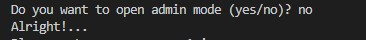
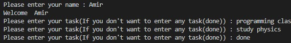
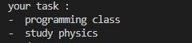

# Personal task manager 📋


A simple Python command-line Task Manager with task storage and environment-based admin password protection.

## Table of contents
[](#-features)
[](#-structure)
[](#file-description)
[](#-requirements)
[](#-installation)
[](#-environment-setup)
[](#️-technologies)
[](#️-usage)
[](#example-output)
[](#-screenshots)
[](#demo-️)
[](#-roadmap)
[](#-author)


## 🚀 Features
- 👤 Enter User Name
- 👋 Personalized Welcome Message
- ➕ Add New Tasks
- 📋 Display All Tasks
- ✅ Finish Adding Tasks with done
- 💾 Save Tasks in tasks.txt
- 🔐 Admin Mode Prompt
- 🔑 Admin Password Configuration Using `.env`


## 📁 Structure

```text
personal_task_manager/
│   .env.example
│   .gitignore
│   main.py
│   README.md
│   tasks.py
│   tasks.txt
├───gifs
│       gif1.gif
│
├───pictures
│       p1.jpg
│       p2.jpg
│       p3.jpg

```

## File Description
|File | Descriptin|
| --- | --- |
| `main.py` | main file used to run calculatore
| `.env.example` | shows the envoirment variables needed by the project
| `.gitignore` | tells git switch files and folders shold not be tracked
| `README.md` | contains the project documantation
| `pictures/` | stores project screenshots
| `gifs/` | A quick preview of the Task Manager in action, showing how users can add, view, and save their tasks.
| `tasks.py` | Contains the add_tasks() function to get task input from the user and return it to the main program.
| `text.txt` | Saved user task

## 📦 Requirements

- `Python 3.13.5`
- `python-dotenv`

## 📥 Installation
1. open a terminal in the project folder.
2. check the python is installed:
```bash
python --version
```
3. if you don't have `Python 3.13.5` installed:
<details>
<summary>
  
</summary>

<br>

1. Enter the official Python 3.13.5 page :
    - [python_website](https://www.python.org/downloads/release/python-3135/?utm_source=chatgpt.com)
2. Go down to the Files section.
3. If your Windows is a regular 64-bit, click `Windows installer (64-bit)` This is the same option that Python `Recommended` introduced.
4. Open the `file.exe` downloaded .
5. On the first installation page, tick select `Add python.exe to PATH`
6. select `Install Now`
7. After installation, open CMD or Terminal: 
```bash
python --version
```
</details>


<details>
<summary>
  
</summary>

<br>

1. Enter the official Python 3.13.5 page :
    - [Download Python 3.13.5 for macOS](https://www.python.org/downloads/release/python-3135/?utm_source=chatgpt.com)
2. Go down to the Files section.
3. for Mac, download the macOS installer with the .pkg extenions.
4. Open the downloaded file and continue with the installation:.
    - Continue/ Agree/ Install
5. After installation, open CMD or Terminal: 
```bash
python --version
```
</details>

## 🔧 Environment Setup

1. Install the required package:
   ```bash
   pip install python-dotenv
   ```

2. Create a `.env` file in the project folder.

3. Add your admin password:
   \`\`\`env
   TASK_MANAGER_ADMIN_PASSWORD=your_password
   \`\`\`

4. Add `.env` to your `.gitignore` file to protect your password.

## ⚙️ Technologies

- `Python 3.13.5`
- `python-dotenv`
- `while` loops
- `if / else`
- File handling


## ▶️ Usage
1. Run the project:
```bash
   python main.py
```
2. Choose whether to open admin mode `yes/no`.
3. Enter your name.
4. Start adding your tasks.
5. Type `done` when you finish.
6. Your tasks will be displayed and saved in `tasks.txt`.

## Example output
```text
    Do you want to open admin mode (yes/no)? no
    Alright!...
    Please enter your name : Sara
    Welcome  Sara
    Please enter your task(If you don't want to enter any task(done)) : study english 
    Please enter your task(If you don't want to enter any task(done)) : do my homework
    Please enter your task(If you don't want to enter any task(done)) : study math
    Please enter your task(If you don't want to enter any task(done)) : done
    your task : 
    - study english 
    - do my homework
    - study math
     
```
## 📷 ScreenShots
### start


### Add tasks


### Show tasks


## Demo 🎞️


## 🎯 Roadmap
- [x] Add user name and welcome message
- [x] Save tasks in a .txt file
- [x] Add and manage a task list
Display all tasks
- [x] Display all tasks
- [ ] Add task editing and deleting options
- [ ] Implement admin password authentication


## 👩‍💻 Author

Create by [Nooshika Fallah](https://github.com/Nooshika88)

